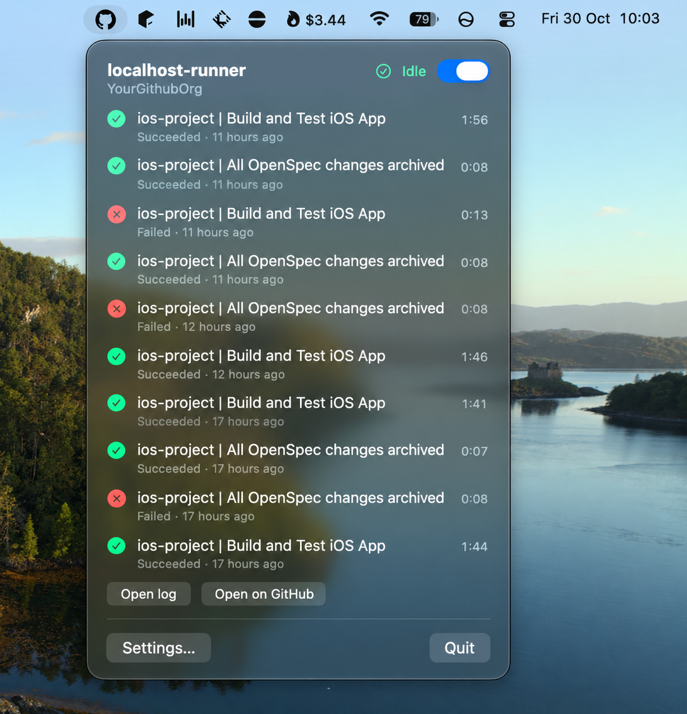

# Actions Runner Monitor

[](https://github.com/thibauult/actions-runner-monitor/actions/workflows/build.yml)
[](https://github.com/thibauult/actions-runner-monitor/releases/latest)
[](https://github.com/thibauult/actions-runner-monitor/releases)


[](LICENSE)

A macOS menu bar app that shows what your self-hosted GitHub Actions runners are doing: paused, idle, or which job is running and for how long. It also lists their recent jobs and whether each one passed.

It needs no setup. It finds every runner you installed as a service with `./svc.sh install` and reads that runner's own files, so there's nothing to fill in.

<p align="center"></p>

| State | Icon |
|---|---|
| A runner's service is down | ⚠︎ |
| A job is running | ⚙︎ plus the elapsed time |
| Every runner is idle | ✓ |

## Install

Download `ActionsRunnerMonitor.zip` from the [latest release](../../releases/latest), unzip it, and move **Actions Runner Monitor.app** to `~/Applications` or `/Applications`.

The release build is ad-hoc signed, not notarized, so macOS blocks it the first time it opens. To clear that, run:

```bash
xattr -dr com.apple.quarantine ~/Applications/"Actions Runner Monitor.app"
```

### Build from source

You need macOS 14 or later and the Xcode command line tools (`xcode-select --install`).

```bash
./build.sh --install
```

That builds a universal app into `build/`, copies it to `~/Applications`, and starts it.

## Settings

Open **Settings…** from the menu bar panel.

| Setting | Default | `defaults` key |
|---|---|---|
| Start at login and reopen if it quits | off | (a launchd agent, see below) |
| How often to check the runners | 3 s | `refreshInterval` (seconds) |
| Recent jobs shown per runner | 10 | `historyLimit` |
| Runners hidden from the menu | none | `hiddenRunners` (comma-separated launchd labels) |

You can also set these from a terminal, for example:

```bash
defaults write io.github.thibauult.actions-runner-monitor refreshInterval -float 5
```

### Staying up

With **Start at login and reopen if it quits** on, the app runs as a launchd agent (`~/Library/LaunchAgents/io.github.thibauult.actions-runner-monitor.plist`) with `KeepAlive`. launchd starts it at login and restarts it if it crashes or something else closes it. **Quit** in the panel still stops it until your next login.

To turn this on or off from a script:

```bash
~/Applications/"Actions Runner Monitor.app"/Contents/MacOS/ActionsRunnerMonitor --install-agent
~/Applications/"Actions Runner Monitor.app"/Contents/MacOS/ActionsRunnerMonitor --uninstall-agent
```

## How it works

- **Discovery.** Each `actions.runner.*.plist` in `~/Library/LaunchAgents` is a runner service. Its `StandardOutPath` is the log the app reads. Its `WorkingDirectory` holds the runner's `.runner` file, which supplies the runner name and the org or repo it's registered to.
- **State.** `launchctl list` tells whether the service is running. A `Runner.Worker` process under it means a job is in progress.
- **Jobs.** The listener writes a `Running job: …` line when a job starts and a `Job … completed with result: …` line when it ends. The app parses the last 512 KB of the log, and only when the log has changed.

The app checks everything off the main thread, and every subprocess it starts has a timeout, so a stuck `launchctl` can't freeze the menu bar.

To see what the app sees without opening the UI, run:

```bash
~/Applications/"Actions Runner Monitor.app"/Contents/MacOS/ActionsRunnerMonitor --dump
```

## License

[Apache License 2.0](LICENSE)
